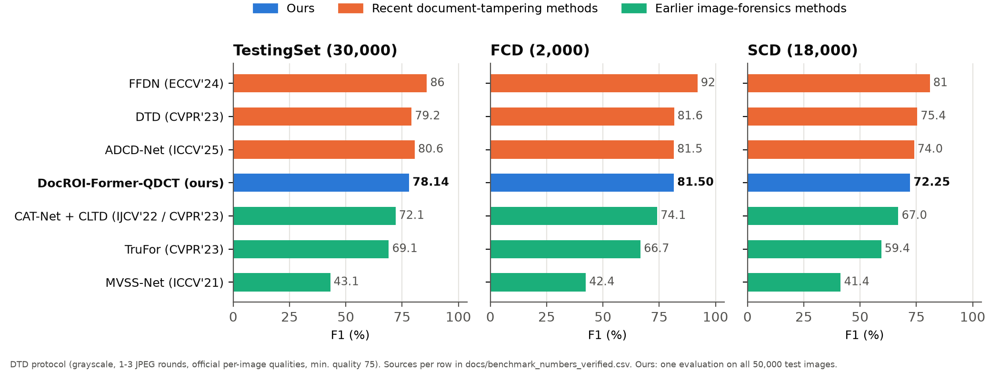
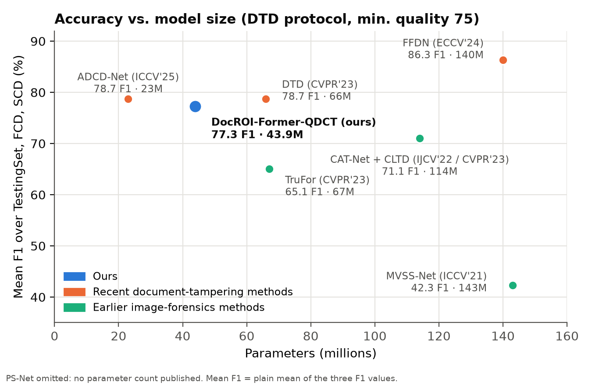
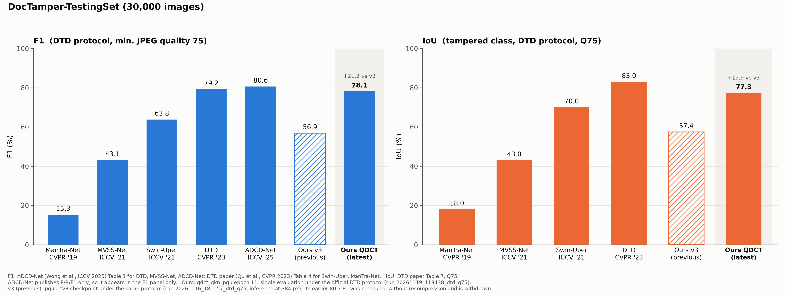
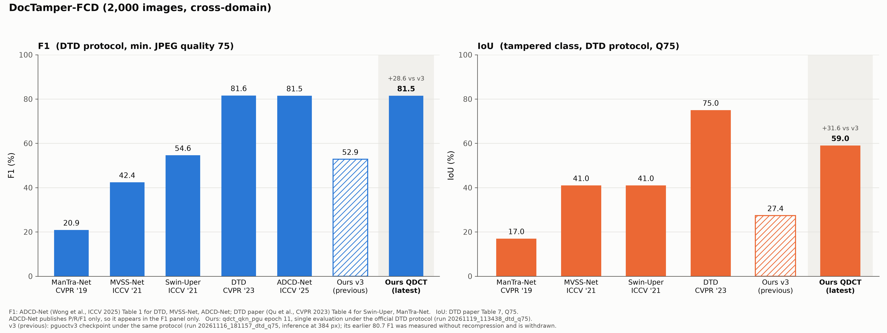
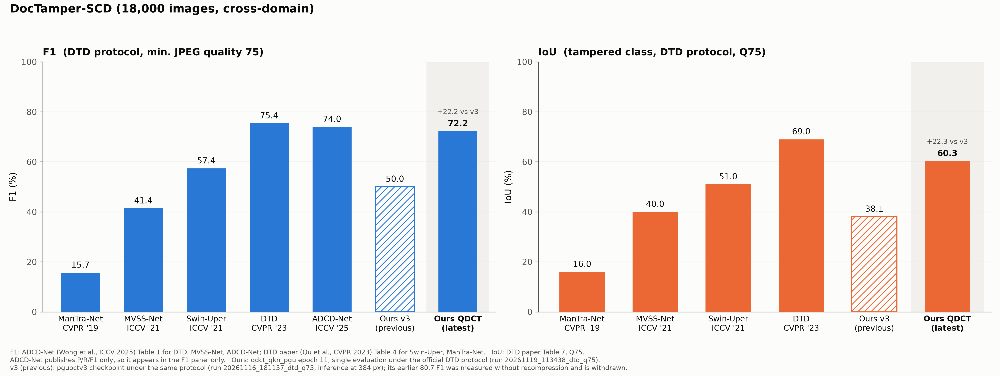
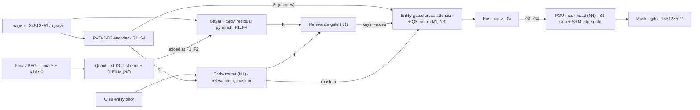

# DocROI-Former-QDCT

**Pixel-level localisation of tampered text in document images. A 43.9M-parameter dual-stream
network, evaluated under the official DocTamper (DTD) protocol.**

Final checkpoint: epoch 11. It was evaluated exactly once, on 2026-11-19, on all 50,000 test
images.

**Research paper:** [`paper/DocROI-Former-QDCT_paper.pdf`](paper/DocROI-Former-QDCT_paper.pdf)
(LaTeX source beside it). It covers the motivation and design use case, the full method, the
experimental protocol, results (F1 and IoU), error analysis, a discussion of why the model
performs well where it does and why it falls short elsewhere, an integrity audit of the
evaluation, and limitations.

The detailed technical specification (every module, equation and setting) is
[`docs/docroi_former_qdct_spec.pdf`](docs/docroi_former_qdct_spec.pdf), with its LaTeX source
beside it (compile with `pdflatex`; the two figure PDFs in `docs/` must sit next to it).

| F1 (%), DTD protocol, min. quality 75 | Params | TestingSet | FCD | SCD | Mean |
|---|---:|---:|---:|---:|---:|
| DTD (CVPR'23) | 66M | 79.2 | 81.6 | 75.4 | 78.7 |
| ADCD-Net (ICCV'25) | 23M | 80.6 | 81.5 | 74.0 | 78.7 |
| FFDN (ECCV'24) | 140M | **86** | **92** | **81** | **86.3** |
| **DocROI-Former-QDCT (ours)** | **43.9M** | **78.14** | **81.50** | **72.25** | **77.3** |

**Bottom line.**
- It is competitive with DTD at two-thirds of DTD's parameter count, and ties ADCD-Net on the
  cross-domain FCD split.
- It is 1–3 F1 below DTD and ADCD-Net on TestingSet and SCD, and well below FFDN.
- It is **not** state of the art. ADCD-Net is both smaller and 1.4 mean-F1 more accurate.



---

## Contents

1. [What the model does](#1-what-the-model-does)
2. [Results](#2-results)
3. [Novelties](#3-novelties)
4. [Architecture](#4-architecture)
5. [Training](#5-training)
6. [Evaluation protocol and integrity rules](#6-evaluation-protocol-and-integrity-rules)
7. [Reproducing the results](#7-reproducing-the-results)
8. [Repository map](#8-repository-map)
9. [Limitations](#9-limitations)
10. [Correction to earlier reported results](#10-correction-to-earlier-reported-results)
11. [References](#11-references)

---

## 1. What the model does

**Input.** A document image at native 512 × 512. Under the protocol the document is grayscale,
replicated to three channels. The model also reads the image's final JPEG encoding: its luma
plane and its quantisation table.

**Output.** A tamper-probability map at input resolution, thresholded at 0.5.

**Training data.** The DocTamper TrainingSet only: 117,500 images for training and 2,500 held
out for validation. The three test sets are never opened during training.

**Test sets:**

| Split | Images | What it measures |
|---|---:|---|
| TestingSet | 30,000 | in-domain |
| FCD | 2,000 | cross-domain |
| SCD | 18,000 | cross-domain |

---

## 2. Results

### 2.1 Comparison with published methods

Every published number was re-checked against its source paper. The full record, with the
source of each value, is [`docs/benchmark_numbers_verified.csv`](docs/benchmark_numbers_verified.csv).

| Method | Venue | Params | TestingSet | FCD | SCD | Mean F1 |
|---|---|---:|---:|---:|---:|---:|
| MVSS-Net | ICCV'21 | 143M | 43.1 | 42.4 | 41.4 | 42.3 |
| CAT-Net + CLTD¹ | IJCV'22 / CVPR'23 | 114M | 72.1 | 74.1 | 67.0 | 71.1 |
| TruFor | CVPR'23 | 67M | 69.1 | 66.7 | 59.4 | 65.1 |
| DTD | CVPR'23 | 66M | 79.2 | 81.6 | 75.4 | 78.7 |
| PS-Net | – | – | 79.8 | 82.7 | 74.1 | 78.9 |
| ADCD-Net | ICCV'25 | 23M | 80.6 | 81.5 | 74.0 | 78.7 |
| FFDN | ECCV'24 | 140M | 86 | 92 | 81 | 86.3 |
| **DocROI-Former-QDCT** | ours | **43.9M** | **78.14** | **81.50** | **72.25** | **77.3** |

**Sources:**
- All rows except FFDN and ours: ADCD-Net, arXiv:2507.16397, Table 1 (values and parameter
  counts, all measured under one recompression protocol).
- FFDN: its ECCV'24 paper, Table 1 (printed there with two decimals) and Table 5 (140M,
  ConvNeXtV2-B).
- Ours: [`reports/dtd_protocol/FINAL_RESULT_ALLTHREELOGGED_RESULT/summary.csv`](reports/dtd_protocol/FINAL_RESULT_ALLTHREELOGGED_RESULT/summary.csv).
- Mean F1 is the plain mean of the three F1 values, computed by us for every row.
- ¹ ADCD-Net's Table 1 labels this row "CAT-Net", but its values are identical to DTD's Table 4
  row "CAT-Net + CLTD" (CAT-Net trained with DTD's curriculum). Plain CAT-Net in DTD's Table 4
  scores 70.0 / 55.3 / 63.1.



> **Published numbers disagree with each other.** FFDN re-trained DTD under identical settings
> and reports F1 0.79 / **0.85** / 0.75, against ADCD-Net's 79.2 / **81.6** / 75.4. We use
> ADCD-Net's Table 1 as the single source for all non-FFDN rows. ADCD-Net's printed "AVG F1"
> column cannot be reproduced from its own F1 values for several rows (for example, DTD's values
> average 78.7 but the column prints 77.8), so we compute the means ourselves.

### 2.2 Full metrics (one evaluation, all test images)

| Split | N | Precision | Recall | F1 | IoU | mIoU |
|---|---:|---:|---:|---:|---:|---:|
| TestingSet | 30,000 | 79.20 | 77.10 | 78.14 | 77.31 | 88.49 |
| FCD | 2,000 | 81.45 | 81.55 | 81.50 | 59.04 | 78.49 |
| SCD | 18,000 | 69.97 | 74.68 | 72.25 | 60.32 | 79.94 |

**What each metric means:**
- **F1** follows DTD: precision and recall are averaged per image, then $F = 2PR/(P+R)$.
- **IoU** is the tampered-class IoU pooled over all pixels of a split, so images with large
  tampered areas dominate it. This is why FCD's IoU (59.0) is far below its F1 (81.5).
- **Comparisons use F1**, the headline metric of the papers above.

The 50,000 per-image rows are in the same folder (`*_per_sample.csv`).

**F1 and IoU per split, against published methods and our previous model.** IoU for the
baselines is from DTD's Table 7 (Q75). ADCD-Net publishes only P/R/F1, so it appears in the F1
panels only. Generated by `scripts/plot_f1_iou_per_split.py`.





### 2.3 Where the model loses points

| Split | F1, tampered area < 1% | 1–5% | 5–15% | Share of images < 1% | F1, 1 JPEG round | 2 rounds | 3 rounds |
|---|---:|---:|---:|---:|---:|---:|---:|
| TestingSet | 70.4 | 90.1 | 96.3 | 62% | 80.6 | 78.4 | 75.3 |
| FCD | 68.1 | 83.6 | 81.8 | 11% | 82.9 | 81.5 | 80.1 |
| SCD | 69.0 | 79.0 | 83.1 | 70% | 73.9 | 71.9 | 71.0 |

**Larger edits are localised well.** Regions above 1% of the image score 90–96 F1 on TestingSet.

**Tiny edits cause almost all of the gap to DTD and ADCD-Net.** These are edits under 1% of the
image, such as a single character. They make up 62% of TestingSet and 70% of SCD.

**Compression is handled well.** Going from one to three JPEG rounds costs 3–5 F1. Our previous
model lost 24 points when compression was added.

---

## 3. Novelties

| | Novelty | Problem it addresses | Relation to prior work |
|---|---|---|---|
| **N1** | **Label-free entity-gated forensic fusion.** A router on stride-4 RGB features separates document content (text, photo, code, seal) from paper, using no entity labels (a heuristic Otsu prior plus a learned classifier). Its relevance map attenuates forensic features on paper, and its entity mask restricts the cross-attention keys to content tokens. | On blank paper, forensic residuals are dominated by scanner noise, texture, folds and glare; tampering happens on content. | ADCD-Net also targets the text/background disparity, through content disentanglement. N1 instead gates both the attention keys and the residual features. |
| **N2** | **Quantisation-table-conditioned DCT injection.** Exact quantised coefficients are recomputed from the final JPEG (in fp32, even under bf16 training), embedded one-hot, conditioned on log Q via zero-initialised FiLM, and added to the residual pyramid at strides 8 and 4. Cost: 0.52M parameters. | Double-compression traces live in the integer coefficient lattice, and a coefficient's meaning depends on compression strength. | One-hot coefficients and Q-table use come from CAT-Net and DTD. The FiLM conditioning, pyramid injection and mixed-precision exactness are ours. |
| **N3** | **Stabilised cross-modal attention.** QK-normalisation (per-head LayerNorm on q and k) at every fusion stage. | Without it, attention logits at the stages with no key normalisation reached 157 and 97, and training diverged in epoch 5. | QK-norm itself is from Dehghani et al. (ICML'23). The diagnosis and its use in cross-modal attention are ours. |
| **N4** | **Progressive guided upsampling (PGU) decoder.** Stride 4 → 2 with an RGB skip and deep supervision, then 2 → 1 at full resolution, where native-resolution SRM residuals enter through a learned tanh gate. | Tampered regions are thin (characters, strokes), and plain upsampling blurs them. | Forensic-residual-guided boundary refinement inside the decoder. |
| **N5** | **Intra-document font-consistency objective.** InfoNCE pulls authentic text tokens of the same document together, and a push term separates tampered tokens. Training only. | Inserted text often differs subtly in typography from the rest of the document. | Auxiliary objective; costs nothing at inference. |

**Evidence status.**
- **System level:** the combination of N1–N5 gives the results above.
- **N3:** its effect is measured (the divergence is removed).
- **N1, N2, N4, N5:** their individual contributions are **not yet isolated by ablation**.

---

## 4. Architecture



The fusion block is repeated at strides 4, 8, 16 and 32. A global head (on $S_4$, $F_4$) and a
font head (on $S_1$) are auxiliary training branches. They are not used at inference or in any
metric.

| Stage | Stride | $S_i$ and $F_i$ | SR ratio | Tokens (Q / KV) | Heads × dim |
|---|---:|---|---:|---|---|
| 1 | 4 | 64×128×128 | 4 | 16,384 / 1,024 | 8×8 |
| 2 | 8 | 128×64×64 | 2 | 4,096 / 1,024 | 8×16 |
| 3 | 16 | 320×32×32 | 1 | 1,024 / 1,024 | 8×40 |
| 4 | 32 | 512×16×16 | 1 | 256 / 256 | 8×64 |

**Parameters**, counted from the checkpoint (43.939M in total):

| Module | Params (M) |
|---|---:|
| PVTv2-B2 RGB encoder | 24.850 |
| Fuse convolutions | 6.932 |
| Forensic residual pyramid | 5.370 |
| PGU mask head | 2.980 |
| Cross-attention (4 stages) | 1.676 |
| Global head | 1.182 |
| Quantised-DCT stream | 0.517 |
| Relevance gates | 0.387 |
| Font head | 0.025 |
| Entity router | 0.019 |

**Loss:** $0.30\,\mathcal{L}_{foc} + 0.40\,\mathcal{L}_{dice} + 0.20\,\mathcal{L}_{bnd} + 0.35\,\mathcal{L}_{aux} + 0.10\,\mathcal{L}_{font} + 0.30\,\mathcal{L}_{glob}$.
The report defines each term.

**Code:**
- `src/models/docroi_former.py`
- `src/models/backbones/frequency_encoder.py` (`QuantizedDCTStream`)
- `src/models/attention/` (router, gates, cross-attention)
- `src/models/heads/mask_head.py`

---

## 5. Training

| Setting | Value |
|---|---|
| Data | DocTamper TrainingSet: 117,500 train / 2,500 held-out validation (seed-42 split) |
| Degradation | Grayscale; 1–3 JPEG rounds; qualities drawn uniformly from {q_min, …, 100} by our own seeded RNG; flips applied after compression |
| Curriculum | q_min 95 → 75 over epochs 1–7 (95, 92, 88, 85, 82, 78), then 75 |
| Resolution | Native 512 × 512, no resizing (the JPEG grid must stay aligned) |
| Optimiser | AdamW, weight decay 0.01 (none on norms, biases or Bayar kernels) |
| Learning rate | 6e-5 for encoders, 3e-4 for router, fusion and heads; 1,000-update warm-up, then cosine to 2% of peak |
| Batch | 4 × 4 accumulation = 16 effective; 12 epochs = 88,125 updates (≈1.41M samples) |
| Precision | bf16 autocast; the quantised-DCT computation runs in fp32; gradient clipping at 1.0 |
| Selection | Best held-out validation F1, threshold 0.5 → epoch 11 |
| Hardware | One RTX 5080 (16 GB), ≈80–86 min per epoch, peak memory 9.7 GiB |

| Epoch | 1 | 2 | 3 | 4 | 6 | 8 | 10 | **11** | 12 |
|---|---|---|---|---|---|---|---|---|---|
| Validation F1 | 40.1 | 52.5 | 62.9 | 68.7 | 73.3 | 75.5 | 76.6 | **76.8** | 76.8 |

**Stability.**
- All 88,125 updates were finite, and the gradient norm stayed at about 4.7–5.4.
- Validation F1 (76.8) and test F1 on TestingSet (78.1) agree, which is consistent with no
  selection leakage.

---

## 6. Evaluation protocol and integrity rules

**Protocol.** This re-implements DTD's evaluation:
- Each test image is converted to grayscale, then JPEG-compressed 1–3 times with DTD's public
  per-image quality tables (`pks/DocTamperV1-<split>_75.pk`), oldest first.
- Inference runs at native resolution in bf16, with a fixed threshold of 0.5 and no test-time
  augmentation.

**Integrity rules, enforced in code:**
- **Training data:** `train_academic.py` opens only the TrainingSet. It never reads DTD's test
  quality tables; training qualities come from our own RNG.
- **Model selection:** uses the 2,500 held-out training images only.
- **Single evaluation:** the selected checkpoint was evaluated **once**. No threshold tuning,
  no re-runs, no test-time tricks.
- **Fingerprints:** `summary.csv` stores the SHA-256 of the checkpoint
  (`76810b6110bf1d42e93247f0f592c346b4740be183f6861561f8e2edba5f0563`) and of each quality table.
  Every number can be tied to exact bytes.
- **Per-image records:** 50,000 rows, so the headline averages can be recomputed independently.

---

## 7. Reproducing the results

**Requirements:**
- Python 3.10+, PyTorch with CUDA, and `pip install -r requirements.txt`.
- The model checkpoint (≈528 MB) is not in git (`runs/` is ignored).

**Data layout**, for evaluation (the DocTamper LMDBs and DTD's `pks` tables):

```
data/Doctamper/DocTamperV1-TestingSet/data.mdb
data/Doctamper/DocTamperV1-FCD/data.mdb
data/Doctamper/DocTamperV1-SCD/data.mdb
data/Doctamper/dtd_official/pks/DocTamperV1-{TestingSet,FCD,SCD}_75.pk
```

**Train** (writes `runs/qdct_qkn_pgu/`):

```bash
python train_academic.py --run_name qdct_qkn_pgu \
  --train_lmdb /path/to/DocTamperV1-TrainingSet \
  --init imagenet --resolution 512 --epochs 12 --batch_size 4 --grad_accum 4 \
  --dct quantized --qk_norm 1 --seed 0
```

On Windows with WSL2, `scripts/wsl_train_academic.sh` wraps this command. It adds a tmux
detach mode, and it automatically resumes at the exact step after a self-healing restart
(exit code 75).

**Evaluate once** (writes `reports/dtd_protocol/<run_id>/`):

```bash
python evaluate_dtd_protocol.py \
  --checkpoint runs/qdct_qkn_pgu/best_docroi_former_qdct_qdct_qkn_pgu.pth \
  --infer_size 0 --datasets TestingSet,FCD,SCD --minq 75 --threshold 0.5
```

**Figures:** `python scripts/plot_f1_iou_per_split.py` regenerates the three F1/IoU figures in
`docs/` from the evaluation records, and `python scripts/plot_f1_overview.py` regenerates
`fig_f1_comparison` and `fig_params_vs_f1` from `docs/benchmark_numbers_verified.csv`.

---

## 8. Repository map

```
configs/docroi_config.py              model, loss and training configuration (dct_mode, qk_norm)
src/models/                           DocROI-Former: backbones, attention (router/gates/cross-attn), heads
src/dataset/doctamper_protocol.py     DTD-protocol degradations, held-out split, JPEG luma + Q-table reader
src/losses/                           focal/Dice, boundary, font-contrastive, combined loss
train_academic.py                     protocol-aligned trainer (watchdog, step-exact resume, provenance)
evaluate_dtd_protocol.py              official-protocol evaluator (summary.csv, SHA-256, per-image CSVs)
scripts/wsl_train_academic.sh         WSL2 launcher with auto-resume
scripts/plot_f1_iou_per_split.py      F1/IoU comparison figures per split
scripts/plot_f1_overview.py           F1 overview and accuracy-vs-size figures
paper/                                research paper (PDF + LaTeX source)
docs/                                 technical specification (.tex), verified benchmark numbers, figures
reports/dtd_protocol/                 official-protocol evaluation records
  FINAL_RESULT_ALLTHREELOGGED_RESULT/   final model, the result reported above
  20261116_*                            previous model (pguoctv3), for reference
```

This repository contains only the research code and records for DocROI-Former-QDCT. Material
from the earlier pguoctv3 model is not included; its numbers were not measured under the DTD
protocol and are superseded (see Section 10).

---

## 9. Limitations

1. **No component ablations yet.** N1, N2, N4 and N5 are supported only by the full-system
   result.
2. **Single run, single seed, no error bars.** The compared papers also report single runs.
3. **Re-implemented protocol.** The evaluator follows DTD's script step by step, but it has not
   been validated by reproducing a published number with DTD's released weights.
4. **Small edits.** F1 is about 70 on edits under 1% of the image area.
5. **Auxiliary heads.** Almost every DocTamper training image is tampered, so the global
   (document-level) head is effectively untrained on authentic documents and **must not be
   used as a classifier**.
6. **Domain.** DocTamper is mostly Chinese-language documents. False-alarm behaviour on other
   document types, including identity documents, has not been measured for this checkpoint.

---

## 10. Correction to earlier reported results

Earlier reports of this project (titled *DocROI-Former v3 / PGU-v3*, checkpoint `pguoctv3`)
made claims that do not hold under the official protocol. **They are withdrawn:**

- **"80.72% F1 on TestingSet, +1.52% over DTD, new SOTA."**
  - That figure was measured on *uncompressed* test images with a per-image metric. DTD's 79.2
    is reported under the compression protocol.
  - Under the official protocol, pguoctv3 scores **56.9 / 52.9 / 50.0** F1 on TestingSet / FCD
    / SCD (`reports/dtd_protocol/20261116_181157_dtd_q75/`).
- **"100% document catch rate, 99.76% document precision."**
  - Every DocTamper test image is tampered, so a detector that flags every image also scores a
    100% catch rate. The figure says nothing about false alarms on authentic documents.
- **The "cumulative ablation" gains and the latency tables.**
  - We could not trace them to controlled ablation runs in this repository's records, so they
    should not be cited.

The current numbers are those in Section 2, from one evaluation of the final checkpoint.

---

## 11. References

- C. Qu *et al.*, "Towards robust tampered text detection in document image: New dataset and new solution," CVPR 2023 (DTD, DocTamper).
- Z. Chen *et al.*, "Enhancing tampered text detection through frequency feature fusion and decomposition," ECCV 2024 (FFDN).
- K. Wong *et al.*, "ADCD-Net: Robust document image forgery localization via adaptive DCT feature and hierarchical content disentanglement," ICCV 2025.
- M.-J. Kwon *et al.*, "Learning JPEG compression artifacts for image manipulation detection and localization," IJCV 2022 (CAT-Net).
- X. Chen *et al.*, "Image manipulation detection by multi-view multi-scale supervision," ICCV 2021 (MVSS-Net).
- F. Guillaro *et al.*, "TruFor: Leveraging all-round clues for trustworthy image forgery detection and localization," CVPR 2023.
- W. Wang *et al.*, "PVT v2: Improved baselines with pyramid vision transformer," CVM 2022.
- M. Dehghani *et al.*, "Scaling vision transformers to 22 billion parameters," ICML 2023 (QK-norm).

**Data.** The DocTamper dataset is distributed by its authors under their own access terms (see
the official DocTamper repository). It is not included here.
